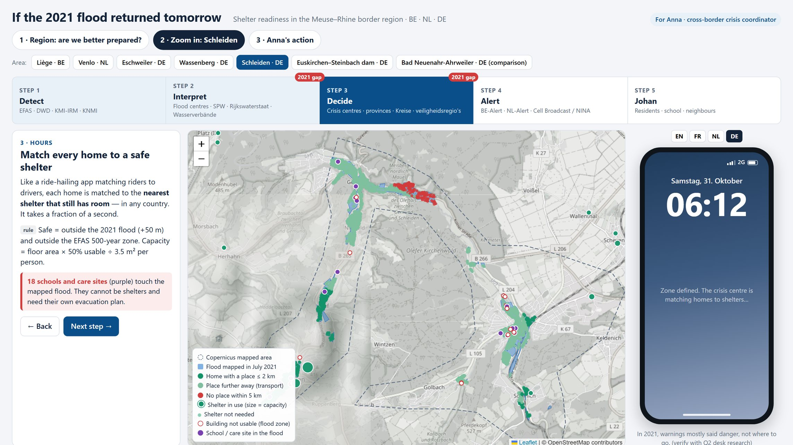

# Johan's Way Out — European AI Challenge 2026

**Team 1's entry to the [European AI Challenge 2026 – From Data to Policy](https://joint-research-centre.ec.europa.eu/events/european-ai-challenge-2026-data-policy-2026-10-29_en)** (Brussels, 29–30 October 2026, organised by [FARI](https://www.fari.brussels) and the European Commission's Joint Research Centre).

> In July 2021 the flood forecast came days early, but most warnings never said *where to go*. We built a tool that matches every home in the flood zone to the nearest safe shelter that still has room, and sends one plain-text alert that answers three questions: **Am I in danger? How serious is it? Where should I go?**

| | Link |
|---|---|
| Policy tool (live) | <https://eu-ai-challenge-policy-tool.vercel.app> |
| Pitch deck (live) | <https://johan-pitch.vercel.app/?motion> |
| Smart Shelter System map | [`ideas/05-smart-shelter-map/`](ideas/05-smart-shelter-map/README.md) |



## The question

Anna coordinates flood crises across Liège, Belgian and Dutch Limburg and Region Aachen. Her ministers ask: *would we be better prepared if the 2021 flood returned tomorrow?* Johan, 11 (a fictional resident), asks something simpler: *where should I go?*

## What we built in two days

- **[Policy tool](policy-tool/README.md)** — six Copernicus-mapped flood areas in Anna's region. Follows the warning chain Detect → Interpret → Decide → Alert, matches every home to the nearest safe shelter with room (across national borders), and writes the alert as plain cell-broadcast text that reaches 2G phones, with the walking route, in DE / FR / NL / EN.
- **[Smart Shelter System](ideas/05-smart-shelter-map/README.md)** — closes every road touched by the 2021 flood or modelled EFAS water, routes residents to shelters on open roads, and flags road stress. Citizen, municipality and full-analysis views.
- **[Pitch deck](presentation/README.md)** — a five-minute interactive deck built around Johan and Anna.

## What we found

In Schleiden, the most exposed area in Anna's region (3,360 homes in the mapped 2021 flood):

- **92 %** of estimated residents get a shelter place within 5 km,
- but only **32 %** can walk there (≤ 2 km), and **8 %** have no place at all.
- Across all six areas: 94 % and 43 %.

**Ready on paper, not yet in practice.** Our recommendation: one cross-border shelter register, so every flood alert (BE-Alert, NL-Alert, Cell Broadcast) names a shelter, starting in Schleiden; plan transport where people cannot walk; and collect Belgian damage records for the Vesdre, which the European data under-measures.

## Data

Copernicus EMS (EMSR517/518/520) · EFAS RP10/100/500 · GHS-POP 2020 · GHS-OBAT R2024A · OpenStreetMap. Residents are modelled estimates, shelters are OpenStreetMap candidate buildings (not designated shelters), and capacities are assumptions; every limit is listed in the tools themselves.

## How we used AI

AI (Claude, Gemini, ChatGPT, Perplexity, NotebookLM) let us build the tools in two days. It also made mistakes — a double count of schools and care sites, cross-border counting that ignored a home's country — which we caught and fixed. Every result was checked twice and every claim traced to its source.

## Team

Team 1, European AI Challenge 2026: Dario Demol, Maryam Mirashrafi, Nahed Lakjaa, Yasser Chamaoui, Yuna Yang and Louis Claes.

Thanks to FARI, the JRC, the jury and the mentors.

---

## Working in this repository

### Start here

1. Read [the annexes](annexes/README.md), especially Annex 2 (data catalogue), Annex 3 (AI use), and Annex 4 (submission and evaluation).
2. Read [the data dictionary](data-analysis/DATA_DICTIONARY.md) before using EMS, EFAS, OBAT or POP.
3. Run `python scripts/check_data.py` to check the compact reference results.
4. Set up [source access](data/README.md), then work in one of the [idea lanes](ideas/README.md).
5. Put reusable code in `scripts/`, reviewable result tables in `data-analysis/`, and generated graphics in `figures/generated/`.

### Structure

| Path | Purpose |
|---|---|
| `annexes/` | Seven original challenge annexes and a short index |
| `data/reference/` | Compact, precomputed tables, audits and prepared event geometry from the current local analysis |
| `data/raw/` | Local/cloud-fetched source files; ignored by Git |
| `data/processed/` | Large local intermediates; ignored by Git |
| `data-analysis/` | Dataset definitions, fact checks, and future analysis notes |
| `ideas/01-...04-.../` | Independent work areas for four coders; assign an owner in each README |
| `scripts/` | Data access, checks and figure generation |
| `figures/reference/` | Five existing PNG/SVG figure pairs, for comparison |
| `figures/generated/` | New figure output; ignored until a reviewed figure is deliberately moved into a tracked location |
| `deliverables/` | Working submissions; output files ignored until reviewed |
| `policy-tool/` | The live policy tool (Vercel root) |
| `presentation/` | The pitch deck (Vercel root of johan-pitch) |

### Work together

Use one branch per task, e.g. `coder-1/ems-event-definition`. Each coder owns an idea lane and may add a script or table under the shared folders. Avoid editing another coder's files in the same branch. A pull request should state the source file or bucket path, geography and dates, units, method, validation command, and any limitation that affects the claim. Review data claims and figure labels before merging. Update the AI usage sheet in Annex 7 as work proceeds.

An idea should move through `ideas/<lane>/README.md` → `scripts/<descriptive-name>.py` → `data-analysis/<descriptive-result>.csv` → `figures/generated/<descriptive-name>.png`. Keep raw downloads in `data/raw/`. If a figure is chosen for the brief, move a reviewed copy to a named folder in `figures/` and record its source table and script in `figures/README.md`.

### Reproduce the existing graphics

```powershell
python -m pip install -r requirements.txt
python scripts/check_data.py
python scripts/generate_reference_figures.py
```

The first four reference charts are regenerated as PNG and SVG in `figures/generated/`. For the fifth map, obtain the EFAS RP500 raster (instructions in `data/README.md`), set `CHALLENGE_DATA_ROOT` to its `working_data` parent if needed, then run `python scripts/generate_reference_figures.py --include-map`. The map also uses the tracked prepared AOI geometry. New graphics should follow the same input/output pattern.

### Scope and provenance

The seven annexes and reference assets were copied from the original local `EU AI challenge` folder. The large `datasets_challenge.zip`, full raw rasters/GeoPackages, brainstorming, guides, audio, and local full-dataset copies are not part of this workspace. The original folder was left intact. The challenge bucket `gs://datasets_challenge/working_data` is the source of raw data; it is read-only and the starter notebook uses anonymous access. Local `data/reference/` files are derived results, with source and limitations documented there.
